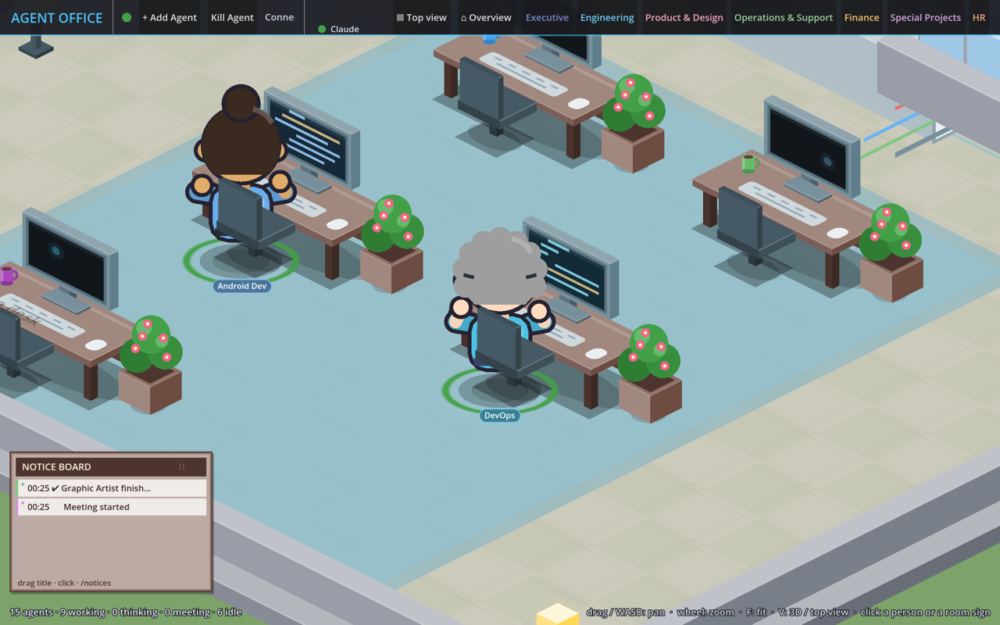
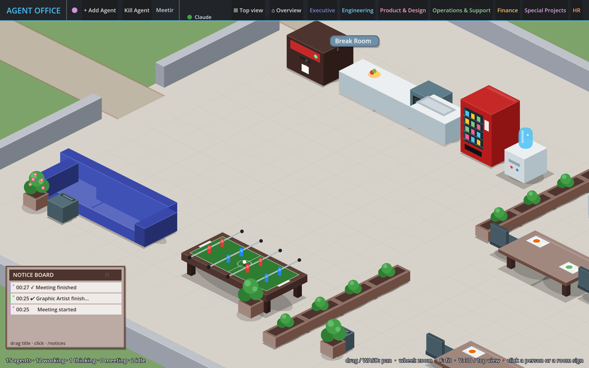
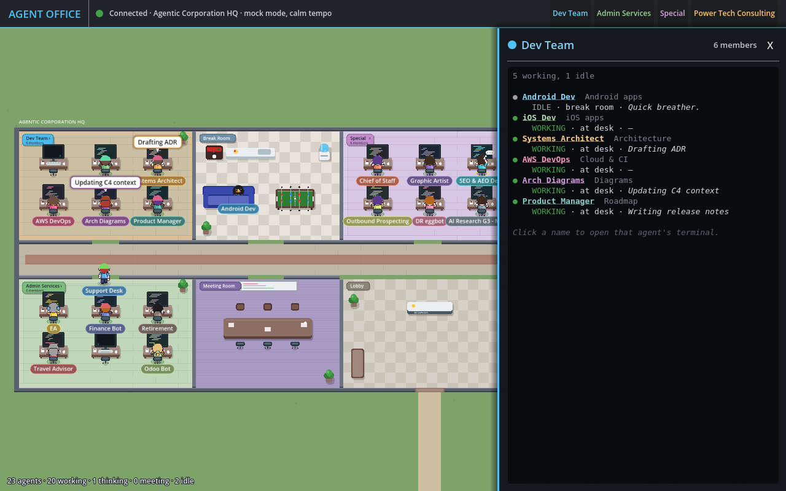
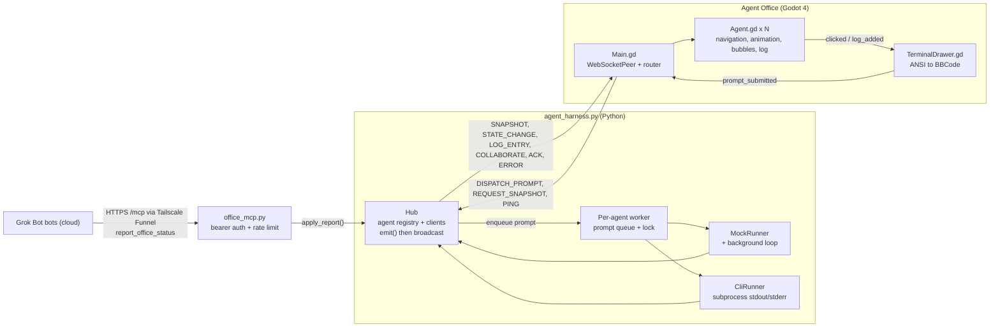

# Agentic Corporation

**Agentic Corporation** is a mission-control dashboard for autonomous agents such as Claude Code, Grok, Hermes or any command-line agent. It looks like a cosy Sims / Habbo / Stardew office. The visual client is called **Agent Office**: a 2D office built in Godot 4 where every agent is a small chibi character at its own desk, and what it does on screen shows what the agent is actually doing.


The office is laid out from **`office.json`**: team rooms with a desk per member and a clickable name sign, a central corridor, a shared **Break Room** (coffee, water cooler, sofa and a foosball table) and **Meeting Room**, and optionally **isolated wings** with their own entrance, kitchenette and meeting nook (the Power Tech Consulting wing has no walkable route into the rest of the building).

| State | What you see |
|---|---|
| `WORKING` | The agent sits in its chair, seen from behind, typing at its own monitor, which scrolls code in the agent's colour. |
| `THINKING` | At the desk: scratches its head while the screen keeps glowing. Elsewhere: a hand on the chin and a "..." cloud. |
| `IDLE` | A break: coffee machine, water cooler, sofa or the occasional foosball game ("Goal!"). The desk monitor drops to a dim screensaver. |
| `COLLAB` | Colleagues take separate seats at the meeting table and talk with their hands. |

When an agent is **away from its desk** (walking, on a break, at foosball or in a meeting) and a log line or a THINKING / WORKING update arrives for it, it pulls out a glowing phone with a little ping bubble.



Clicking an agent slides out a **terminal drawer** with its live log, colour codes included, and a prompt bar that sends work back to that agent. Clicking a **room sign** shows a team summary (members, state, where they are, latest status).

A small Python **event bridge** (`agent_harness.py`) drives the office over a local WebSocket. It either simulates agents (mock mode) or wraps real CLI processes and streams their output (cli mode).



## Quick start

> **macOS shortcut:** double-click `run-mac.command` to create the venv on first run (Python 3.10+; it picks the newest `python3.x` it finds), start the bridge with the MCP connector on port 8766, print where the token is, and open the Godot client (needs `godot` on your PATH, e.g. `brew install --cask godot`). The bridge stops when you close the game. It reinstalls the requirements whenever `requirements.txt` changes.

### 1. Run the harness

You need Python 3.10 or newer.

```bash
git clone https://github.com/pvella/Agentic-Corporation.git
cd Agentic-Corporation

python3 -m venv .venv
source .venv/bin/activate          # Windows: .venv\Scripts\activate
pip install -r requirements.txt    # websockets>=13

python3 agent_harness.py           # mock mode on ws://127.0.0.1:8765
```

**Mock mode** (the default) simulates the agents from `office.json` (23 of them in four rooms), or the three legacy agents `coder_agent`, `qa_agent` and `architect_agent` when there is no config. Activity is role-flavoured and fake: the iOS Dev runs `xcodebuild archive`, Finance Bot is "Reconciling Betashares...", and so on. No real data is used.

The office runs at a **tempo** (`--tempo`, default `calm`):

| | calm (default) | normal | busy |
|---|---|---|---|
| Desk session | 20–60 s | 12–30 s | 4–10 s |
| Log line while working | every 5–12 s | 3–7 s | 1–3 s |
| THINKING pause | 15% chance, 4–8 s | 20%, 3–6 s | 25%, 1.5–3 s |
| Break after a session | 25% chance, 15–30 s | 40%, 10–20 s | 60%, 4–8 s |
| Meeting | every 3–6 min, 25–45 s | every 1–2 min, 15–30 s | every 15–30 s, 8–15 s |
| Foosball (2 players) | every 5–10 min, 40–80 s | every 2–4 min, 25–45 s | every 30–60 s, 10–20 s |
| Walk slot (min gap between walk starts) | 6 s | 4 s | 1.5 s |

Every interval is randomised per agent. Agents start seated at their desks, and only one walk starts per walk slot, so at most a few people are on the move at once even with 23 agents. Measured over 20 simulated minutes with the default office: calm = 5.5 walks per minute for the whole office (each agent walks every ~4 minutes, peak ~3 walking at once); normal = 12 per minute. `--speed X` scales all of it (2 = twice as fast).

A prompt sent from the dashboard is handled straight away (the harness reacts in a few milliseconds): THINKING → WORKING at the desk → logs → IDLE at a break spot. The calm tempo only applies to background activity.

```bash
python3 agent_harness.py --tempo normal          # livelier office
python3 agent_harness.py --tempo busy --speed 2  # stress test
python3 agent_harness.py --no-ambient            # only react to prompts
python3 agent_harness.py --office none           # legacy 3-agent office
python3 agent_harness.py --office ~/my-office.json
```

**CLI mode** binds a real command to an agent. Each prompt launches that command, streams every stdout/stderr line into the agent's log with ANSI colours kept, and maps process start and exit to WORKING and IDLE.

```bash
# Claude Code in print mode; the prompt is appended as the last argument
python3 agent_harness.py --mode cli --cwd ~/code/myrepo \
  --agent-cmd coder_agent='claude -p --output-format text'

# Any command. {prompt} is substituted where it appears; --prompt-mode none sends no prompt
python3 agent_harness.py --mode cli --prompt-mode none \
  --agent-cmd qa_agent="bash -c 'pytest -q --color=yes'"
```

| Option | Default | Meaning |
|---|---|---|
| `--mode mock\|cli\|live` | `mock` | Choose the runner. `live` = no simulation at all: agents only move on real status reports (MCP) and CLI runs. |
| `--agent-cmd ID='CMD'` | none | Bind a command to an agent (repeatable, cli mode). |
| `--prompt-mode arg\|stdin\|none` | `arg` | How the prompt reaches the command when `{prompt}` isn't used. |
| `--cwd DIR` | current directory | Working directory for CLI commands. |
| `--cmd-timeout N` | `0` (no limit) | Kill a CLI run after N seconds. |
| `--office PATH\|none` | `office.json` next to the script, if present | Office config; `none` forces the legacy 3-agent office. |
| `--tempo calm\|normal\|busy` | `calm` | Background activity level (see the table above). |
| `--speed X` | `1.0` | Time multiplier for background activity and mock prompt runs. |
| `--no-ambient` / `--ambient` | | Turn background activity off (mock mode) or on for agents without a command (cli mode). |
| `--host` / `--port` | `127.0.0.1` / `8765` | WebSocket listen address (the Godot client). |
| `--mcp-port N` / `--no-mcp` | `8766` | Port of the MCP connector at `/mcp` (see "Live status from Grok Bot"); `--no-mcp` or `0` turns it off. |
| `--mcp-host` | `127.0.0.1` | MCP bind address. Leave it on localhost; Tailscale Funnel proxies to it. |
| `--mcp-token-file PATH` | `.office_token` next to the script | Where the generated bearer token is kept. `OFFICE_MCP_TOKEN` in the environment wins. |
| `--mcp-rate N` | `60` | Max MCP requests per minute per token (bursts of up to 20); extra calls get HTTP 429. |
| `--live-hold SECONDS` | `600` | After a real report, the simulation leaves that agent alone this long. |
| `-v` | | Debug logging. |

In cli mode, agents without a `--agent-cmd` fall back to the mock runner when given a prompt. Prompts for the same agent are queued and run one at a time. Ctrl+C shuts down cleanly and kills any running process groups (SIGTERM, then SIGKILL after 3 s).

### Editing `office.json`

```json
{
  "name": "Agentic Corporation HQ",
  "rooms": [
    {"id": "dev_team", "name": "Dev Team", "color": "#4fc3f7", "theme": "wood", "desks": 6,
     "members": [{"agent_id": "ios_dev", "name": "iOS Dev", "role": "iOS apps"}]},
    {"id": "ptc", "name": "Power Tech Consulting", "color": "#ffb74d", "theme": "navy", "isolated": true,
     "members": [{"agent_id": "ptc_odoo", "name": "PTC Odoo", "role": "Odoo"}]}
  ],
  "shared": {"break_room": {"name": "Break Room"}, "meeting_room": {"name": "Meeting Room", "seats": 6}}
}
```

- **Move a bot** by moving its member entry to another room's `members` list. **Add a room** by adding an object to `rooms`; the floor plan grows automatically (rooms alternate above and below the corridor, with the break room and meeting room in the middle).
- `agent_id` must be a unique lowercase slug (`a-z`, `0-9`, `_`). Its desk waypoint is `Desk_<agent_id>`.
- `name` and `role` are display text. `role` also picks the flavour of the mock activity (keywords such as ios, android, devops, finance, travel, support, odoo, seo, research).
- `color` (optional) is the agent's/room's accent colour; members without one get a distinct colour from a palette. `theme` is the floor: `wood`, `sage`, `lilac`, `navy`, `tile` or `carpet`. `desks` reserves extra free desks.
- `"isolated": true` makes the room a **separate walled-off wing** with its own exterior door, kitchenette (`<id>_Coffee`, `<id>_Water`), sofa and 4-seat meeting table (`<id>_Meeting_1..4`, virtual target `<id>_Meeting_Room`). There is no door between it and the main building, its agents never use the shared break or meeting rooms, and the mock director never mixes them with other rooms.
- `shared.meeting_room.seats` sets the meeting table size (2–8).
- **Only names, roles and room membership belong in this file.** No secrets, tokens, account ids or ids from other systems: the whole file is sent to every connected client.

Restart the harness after editing; connected Godot clients rebuild the office automatically.

### 2. Open the office in Godot

You need Godot **4.3 or newer**, the standard (non-.NET) build from [godotengine.org](https://godotengine.org/download), on macOS, Windows or Linux. The project uses the GL Compatibility renderer.

1. Open Godot's Project Manager and choose **Import**. Select `project.godot` in this folder, then **Import & Edit**. The first open builds the import cache in `.godot/`, which git ignores.
2. Press **F5** (Run Project). `Main.tscn` is the main scene.
3. The top bar shows the connection status. The client retries the connection with increasing delays (1 s, doubling up to 15 s), so you can start the harness and Godot in either order.

From the command line, with `godot` on your PATH (on macOS the binary is `Godot.app/Contents/MacOS/Godot`):

```bash
godot --path .                                   # run the office
godot --path . -- --url=ws://127.0.0.1:9000      # connect to another port
godot --path . -- --open-drawer=coder_agent --dispatch="coder_agent:Fix bug in auth.py"
godot --path . -- --screenshot=res://shot.png --screenshot-delay=8 --quit-after-screenshot
godot --path . --resolution 1920x1080 -- --zoom=2 --focus-agent=ios_dev   # follow one agent
```

Options after `--`:
- `--url=` overrides the server address.
- `--open-drawer=ID` opens that agent's terminal once it appears.
- `--dispatch=ID:prompt` sends one prompt after connecting.
- `--screenshot=PATH` saves the viewport after `--screenshot-delay` seconds (default 6). This needs a real renderer, not `--headless`.
- `--quit-after-screenshot` exits once the screenshot is saved. `--screenshot-every=S --screenshot-count=N` saves a numbered series.
- `--open-team=ROOM_ID` opens a team summary once agents appear.
- `--zoom=Z` with `--focus=x,y` or `--focus-agent=ID` starts the camera zoomed in (the latter follows the agent).

If you switch the same checkout between Godot 4.3 and 4.4+, run `godot --headless --path . --import` with the version you are about to use: the two write incompatible `.godot/` class caches.

## Live status from Grok Bot (MCP)

Your real bots can drive their own characters. The harness also serves a small **remote MCP connector** (Streamable HTTP, built on the official `mcp` Python SDK) with one tool, `report_office_status`. A cloud-hosted bot calls it over the internet through **Tailscale Funnel** on your Mac, and its character reacts straight away.

```
Grok Bot (cloud) --HTTPS--> https://<mac>.<tailnet>.ts.net/mcp --Funnel--> 127.0.0.1:8766/mcp --> harness --WebSocket :8765--> Godot
```

| | |
|---|---|
| Endpoint (local) | `http://127.0.0.1:8766/mcp` (POST JSON-RPC; `--mcp-port` changes the port) |
| Endpoint (public) | `https://<your-mac>.<your-tailnet>.ts.net/mcp` once Funnel is on |
| Auth | Every request needs the header `Authorization: Bearer <token>`. Anything else gets HTTP 401. |
| Token | `OFFICE_MCP_TOKEN` from the environment, or generated on first run into `.office_token` (chmod 600, git-ignored) and printed once. Read it again with `cat .office_token`; delete the file and restart to rotate it. |
| Transport | MCP Streamable HTTP, stateless, JSON responses (protocol 2025-03-26 and later). `GET` and `DELETE` return 405 because there are no server-push streams or sessions. |

### The tool

`report_office_status(agent, action, detail)`

- `agent` (required): the bot's name exactly as in `office.json`, e.g. `"Android Dev"`. Matching ignores case and extra spaces, and the `agent_id` (`android_dev`) works too. An unknown name returns a tool error that lists every valid name.
- `action` (required): one of the values below.
- `detail`: one short sentence. Control characters and ANSI codes are stripped, and it's cut to 200 characters.

| `action` | What the character does |
|---|---|
| `start_task` | Walks to its desk and starts typing (`WORKING`); `detail` appears as a bubble and a `▶` line in its terminal. |
| `thinking` | At the desk, scratching its head with a thought bubble (`THINKING`). |
| `run_tool` | Keeps working at the desk; `detail` goes in the bubble and as a `$ ...` line in the terminal. |
| `finish` | Logs `✔ Done`, then heads off for a break (its room's break spots: the shared break room, or the PTC wing's own kitchenette). |
| `error` | Stays at the desk with a red monitor, a pulsing red `!` and a red ring (`ERROR`); the HUD counts errors. The next report clears it. |

The result is just `ok`.

### Mixed and live modes

- **Mock mode (default):** everyone is simulated, but as soon as a bot reports for real the simulation leaves **that** agent alone for 10 minutes after its latest report (`--live-hold`), so real status is never overwritten. Everyone else keeps the calm simulation. When the hold runs out, the simulation picks up again from where the bot left off.
- **Live mode (`--mode live`):** no simulation at all. Everyone starts seated with their screens off and only moves on real reports (or on CLI runs bound with `--agent-cmd`). Prompts typed into the dashboard for agents without a command are logged, not run.

```bash
python3 agent_harness.py                    # simulated office + live overrides, MCP on :8766
python3 agent_harness.py --mode live        # only real reports move people
python3 agent_harness.py --no-mcp           # no connector
```

If the harness (or the Mac, or Funnel) is down, the bots' calls simply fail. Nothing is queued, and the instruction below tells the bots to ignore the failure and carry on.

### Expose it with Tailscale Funnel

One-time setup:

1. Install Tailscale on the Mac and log in.
2. In the tailnet admin console, enable **MagicDNS** and **HTTPS certificates**, and allow **Funnel** for this device (the policy needs the `funnel` node attribute). The first `tailscale funnel` command prints a link to do this if it isn't allowed yet.

Then, with the harness running:

```bash
tailscale funnel --bg 8766          # or: tools/funnel-mac.sh on
tailscale funnel status             # shows https://<mac>.<tailnet>.ts.net -> http://127.0.0.1:8766
```

The connector URL is `https://<mac>.<tailnet>.ts.net/mcp` (`tools/funnel-mac.sh url` prints it). `--bg` keeps Funnel on across reboots until you turn it off:

```bash
tailscale funnel --https=443 off    # or: tools/funnel-mac.sh off
tailscale funnel reset              # clears every serve/funnel setting on this Mac
```

Only port 8766 is exposed. The WebSocket (8765) stays on localhost.

### Connect your bots

Add a remote MCP connector in Grok Bot with:

- **URL:** `https://<mac>.<tailnet>.ts.net/mcp`
- **Header:** `Authorization: Bearer <token>` (the contents of `.office_token`)

Then add this to each bot's instructions, with its own name:

> Whenever you start a task, make real progress, or finish/fail a job, call report_office_status with agent="<your name>" and a one-sentence detail. If the call fails, ignore it and carry on.

Test it from a terminal first:

```bash
TOKEN=$(cat .office_token)
curl -s https://<mac>.<tailnet>.ts.net/mcp \
  -H "Authorization: Bearer $TOKEN" -H "Content-Type: application/json" \
  -H "Accept: application/json, text/event-stream" -H "MCP-Protocol-Version: 2025-03-26" \
  -d '{"jsonrpc":"2.0","id":1,"method":"tools/call","params":{"name":"report_office_status",
       "arguments":{"agent":"Android Dev","action":"start_task","detail":"Building the release APK"}}}'
# {"jsonrpc":"2.0","id":1,"result":{"content":[{"text":"ok","type":"text"}],"isError":false}}
```

## Controls

| Input | Action |
|---|---|
| Left-click an agent | Open its terminal drawer. The agent gets a white selection ring. Hovering shows a faint ring. |
| Left-click a room sign, or a room name in the top bar | Open that room's team summary. Click a member's name in it to open their terminal. |
| Drag (left on the floor, or middle / right anywhere), **WASD** / arrow keys, trackpad two-finger scroll | Pan. |
| Mouse wheel, pinch, **+** / **-** | Zoom (about the cursor). |
| **F** or **Home** | Fit the whole office in the window. |
| Type in the prompt bar, then **Enter** or **Send** | Send a `DISPATCH_PROMPT` to the selected agent. If you're offline, the drawer says the prompt wasn't sent. |
| **Esc** or **X** | Close the drawer. |



The window opens at 1280x800 and can be resized; the office is fitted to the window at start. Name pills and bubbles grow slightly when you zoom out so they stay readable. The coloured ring at each agent's feet shows its state: grey for IDLE, green for WORKING, yellow for THINKING and purple for COLLAB.

## Stores / distribution

There is no packaged build or store listing yet. Agentic Corporation is a **local desktop tool**: you run the harness and the Godot project from source on your own machine.

## Stack

- **Harness:** Python 3.10+, `asyncio` and `websockets` (13 or newer, using the `websockets.asyncio` API, with a fallback to the legacy API for version 12). Tested with websockets 17.2 on Python 3.13 and 3.14.
- **MCP connector:** the official `mcp` Python SDK (2.3; `MCPServer` with the Streamable HTTP transport, served by uvicorn inside the harness's event loop). It is optional: without the package the harness logs a warning and runs without the connector.
- **Client:** Godot 4.3+ in typed GDScript, using the GL Compatibility renderer. There are no external assets: all art is drawn procedurally in code (see [CREDITS.md](CREDITS.md)). Tested on **Godot 4.3-stable and 4.7.2-stable** (Linux).

## Components

| File | Purpose |
|---|---|
| `agent_harness.py` | WebSocket server. Holds the agent registry and broadcasts every event. Loads `office.json`, includes `MockRunner` (role-flavoured scripted runs), `AmbientDirector` (the tempo-driven background simulation), `CliRunner` (wraps a real process and streams its output) and a per-agent prompt queue. |
| `office.json` | Rooms, members and shared spaces (see "Editing office.json"). |
| `office_mcp.py` | The MCP connector: `report_office_status` tool, bearer-token check, rate limits, token file. Started by the harness. |
| `requirements.txt` | Python dependencies (`websockets>=13`, `mcp>=2.3,<3`). |
| `project.godot` | Godot project settings: 1280x800, resizable (stretch `canvas_items`, aspect `expand`), GL Compatibility, main scene `Main.tscn`. |
| `Main.tscn` / `Main.gd` | The office scene. Builds the office from `OFFICE_LAYOUT` (or the legacy layout), creates the waypoints, furniture, room signs and navigation, runs the `WebSocketPeer` client with automatic retry, routes messages, assigns seats and spreads agents at shared spots, and drives the HUD. |
| `Office.gd` | The layout builder and floor painter: turns the config into rooms, doors, walls, the corridor and wings, desks, amenities, waypoints, signs and the navigation outlines, and draws floors, walls and signs. |
| `Prop.gd` | One piece of furniture, y-sorted with the agents: desks with a live monitor (scrolling code / screensaver), chairs, coffee machine, water cooler, sofa, the animated foosball table, meeting table, plants, reception. |
| `CameraController.gd` | Pan / zoom / fit camera with world bounds. |
| `Agent.tscn` / `Agent.gd` | One agent: a `CharacterBody2D` that strolls with `NavigationAgent2D` (gentle acceleration, settles exactly into its seat, avoids other agents). Draws the chibi character procedurally (front and back views, poses, blinking, phone), a name pill, a speech or thought bubble (fades after 3 s), its own log (up to 1000 lines), and an `AnimatedSprite2D` hook for sprite sheets. |
| `TerminalDrawer.tscn` / `TerminalDrawer.gd` | The slide-out drawer on a `CanvasLayer`: an agent's terminal (header, `RichTextLabel` log, prompt bar) or a room's team summary. It updates live while open. |
| `ansi.gd` | Converts ANSI colour codes to Godot text markup: 16/256/truecolour, bold, dim, italic and underline. Other escape sequences are stripped and literal `[` is escaped. |
| `icon.svg` | Project icon. |
| `CREDITS.md` | Art and asset credits (all original, procedural). |
| `tests/test_ansi.gd` | Headless unit tests for the colour converter. |
| `tests/smoke_test.gd` | Headless integration test that loads `Main.tscn` and feeds it protocol messages (legacy office and the team-room office). |
| `tests/fixtures/office_layout.json` | The `OFFICE_LAYOUT` the harness sends for the default `office.json`, used by the smoke test. |
| `tests/test_office_mcp.py` | Python unit tests for the MCP connector (auth, tools/list, tool calls reaching a WebSocket client, unknown agents, truncation, mixed and live modes, rate limit, token file). |
| `tools/test_client.py` | Python test client for the harness protocol, in mock and cli modes. |
| `tools/funnel-mac.sh` | `on` / `off` / `status` / `url` helper for Tailscale Funnel on the MCP port. |
| `tools/tempo_check.py` | Watches the harness and reports walks per minute, dwell times and how many agents walk at once. |
| `docs/images/` | Screenshots used in this README. |

The `*.uid` files are Godot 4.4+ resource IDs and belong in version control. Godot 4.3 ignores them.

## Architecture



- **The harness is the source of truth.** Every event updates the registry before it is broadcast, so a newly connected or reconnected client receives an accurate `SNAPSHOT`, including each agent's last 200 log lines.
- **The client rebuilds itself from snapshots.** A snapshot spawns missing agents, removes ones the server no longer knows about, and re-routes agents whose target changed. An event for an unknown `agent_id` spawns that agent on the fly.
- **The floor plan is generated.** `Office.build()` turns the layout into rooms, walls with doors onto the corridor, desks and amenities. `Main._bake_navigation()` feeds the floor outline plus every wall and furniture footprint into `NavigationMeshSourceGeometryData2D` at runtime, so there is no editor step. An isolated wing is separated from the building by a solid band, so it becomes its own navigation island.
- **Agents stroll.** About 88 px/s (the old client used 140), with gentle acceleration and braking, a short settle into the exact seat, no re-pathing when told to go where they already are, and the facing taken from the waypoint (desk chairs face the monitor).
- **Waypoints** are `Marker2D` nodes under `Main/Waypoints`, each with `facing` and `seat` metadata:
  - `Desk_<agent_id>` (legacy: `Desk_Coder`, `Desk_QA`, `Desk_Architect`)
  - shared: `Coffee_Machine`, `Water_Cooler`, `Sofa_1`, `Sofa_2`, `Foosball_1`–`Foosball_4`, `Meeting_Table_1`–`Meeting_Table_N`, `Entrance`
  - isolated room `<id>`: `<id>_Coffee`, `<id>_Water`, `<id>_Meeting_1`–`<id>_Meeting_4`, `<id>_Entrance`

  The virtual targets `Meeting_Room` and `<id>_Meeting_Room` resolve to the least-occupied seat. Agents sharing a standing spot each take the lowest free slot around it.

## WebSocket message protocol

All messages are JSON text frames on `ws://127.0.0.1:8765`. Every server-to-client message also carries `ts` (epoch milliseconds).

### Server to client

| `type` | Fields | Client behaviour |
|---|---|---|
| `OFFICE_LAYOUT` | `office{name, rooms[{id,name,color,theme,desks,isolated,members[{agent_id,name,role,color,desk}],break_spots,meeting_target}], shared{break_room,meeting_room}}` | Sent on connect, before the `SNAPSHOT`, when the harness has an office config (and in reply to `REQUEST_LAYOUT`). The client rebuilds the floor plan if it changed. Without it the client uses the legacy 3-desk office. |
| `SNAPSHOT` | `server{name,version,mode,tempo,office}`, `agents[{agent_id,name,role,room,desk,color,state,target,text,busy,queued,live,logs[]}]` | Sent when a client connects and in reply to `REQUEST_SNAPSHOT`. The client spawns, updates and removes agents to match (new agents appear directly at their spot), and restores their logs. |
| `STATE_CHANGE` | `agent_id`, `state` (`IDLE`, `WORKING`, `THINKING`, `COLLAB`, `ERROR`), optional `target`, optional `text` | Sets the animation state, walks to `target` if given, and shows `text` as a bubble (a thought bubble when `THINKING`). |
| `LOG_ENTRY` | `agent_id`, `log` (raw text, may contain ANSI codes), `stream` (`stdout` or `stderr`) | Appends to the agent's log, and to the drawer if it's open. |
| `COLLABORATE` | `agents[]`, `target` (`Meeting_Room` or a waypoint), optional `text` | Every listed agent switches to `COLLAB` and takes its own seat. The first agent shows the bubble. |
| `ACK` | `action`, `agent_id`, `prompt`, `queued` | Sent only to the client that sent a valid `DISPATCH_PROMPT`. |
| `ERROR` | `message`, optional `action`, `agent_id` | Sent for bad JSON, an unknown action or agent, or an empty prompt. |
| `PONG` | none | Reply to `PING`. |

Example:

```json
{"type": "STATE_CHANGE", "agent_id": "coder_agent", "state": "WORKING", "target": "Desk_Coder", "text": "Editing main.py"}
```

### Client to server

| `action` | Fields | Effect |
|---|---|---|
| `DISPATCH_PROMPT` | `agent_id`, `prompt` | Queues the prompt for that agent; it starts at once if the agent isn't already running one. The reply is `ACK` or `ERROR`. |
| `REQUEST_LAYOUT` | none | The reply is `OFFICE_LAYOUT` (or `ERROR` for the legacy office). |
| `REQUEST_SNAPSHOT` (alias `GET_REGISTRY`) | none | The reply is a `SNAPSHOT`. |
| `PING` | none | The reply is `PONG`. |

```json
{"action": "DISPATCH_PROMPT", "agent_id": "coder_agent", "prompt": "Fix bug in auth.py"}
```

## Running the tests

```bash
# Harness protocol test, mock mode (office.json; calm tempo has few ambient events, hence 0)
python3 agent_harness.py &
python3 tools/test_client.py --expect-layout yes --min-ambient-events 0 --agent ios_dev
kill %1

# Legacy office and busy tempo
python3 agent_harness.py --office none --tempo busy &
python3 tools/test_client.py --expect-layout no --agent coder_agent
kill %1

# Harness protocol test, cli mode (checks ANSI lines, the stderr stream and the exit code)
python3 agent_harness.py --mode cli \
  --agent-cmd ios_dev="bash -c 'for i in 1 2 3; do echo -e \"\e[32mline \$i\e[0m\"; sleep 0.3; done'" &
python3 tools/test_client.py --expect-cli --agent ios_dev --min-ambient-events 0
kill %1

# How calm is calm? Observe 20 simulated minutes at 10x speed
python3 agent_harness.py --speed 10 --port 8770 &
python3 tools/tempo_check.py --url ws://127.0.0.1:8770 --speed 10 --seconds 120
kill %1

# MCP connector unit tests (needs requirements.txt installed; starts its own harness on free ports)
python3 -m unittest discover -s tests -p 'test_*.py' -v

# Godot tests. Import once so the class cache exists, then run headless.
godot --headless --path . --import
godot --headless --path . --script res://tests/test_ansi.gd     # colour converter unit tests
godot --headless --path . --script res://tests/smoke_test.gd    # layouts, spawning, seating, meetings, foosball, phone, PTC wall, drawer
```

`smoke_test.gd` needs no harness: it feeds messages straight into `Main`. Each script exits with code 0 on success and 1 on failure. If you change `office.json`, regenerate the fixture with `python3 -c "import json, agent_harness as h; json.dump({'type': 'OFFICE_LAYOUT', 'office': h.load_office(None)}, open('tests/fixtures/office_layout.json', 'w'), indent=1)"`.

## Security

- The WebSocket listens on **127.0.0.1 only** and has **no authentication**. Any local process can connect and send prompts.
- The **MCP connector** also binds to 127.0.0.1 and is the only part meant to be exposed (through Tailscale Funnel). Every request needs the bearer token (compared in constant time); bad tokens get 401 and are throttled per client, valid traffic is rate-limited (`--mcp-rate`), request bodies are capped at 64 KB, and `detail` is cleaned and capped at 200 characters. The tool can only move characters and add log lines: it can't run commands or send prompts. Keep `.office_token` private (it's git-ignored and chmod 600) and rotate it by deleting the file and restarting.
- In **cli mode, a prompt runs a real command** on your machine with your user's permissions, in `--cwd`. Only bind commands you trust, and point `--cwd` at a working copy you're happy for an agent to change.
- Don't expose the WebSocket port (8765) beyond localhost (`--host 0.0.0.0`, port forwarding, tunnels).

## Roadmap

- **Art:** optional sprite sheets through the existing `Agent.sprite_frames` hook (animations `idle`, `walk`, `work`, `think`, `collab`, `phone`), e.g. CC0 packs, recorded in `CREDITS.md`.
- **Claude Code:** parse `claude -p --output-format stream-json` so tool calls drive desk work (tool name in the bubble), assistant text becomes thinking or speech bubbles, and `result` ends the run.
- **Other agents:** adapters for Grok and Hermes CLIs and for other agent output formats.
- **Security:** an auth token on the WebSocket too, so the dashboard could be used remotely.
- **Hand-offs:** `COLLABORATE` events when one agent passes work to another, e.g. coder to QA review.

## Limitations

- All art is drawn in code. There are no sprites, no tiles and no sound.
- An agent that isn't in `office.json` (for example a new id from cli mode) still spawns, but it has no desk of its own and uses a break spot instead.
- CLI mode treats output as plain lines. It doesn't understand structured output such as stream-json yet, so tool calls don't drive the animation beyond WORKING and the latest line in the bubble.
- The shared meeting room has 2–8 seats (`shared.meeting_room.seats`) and isolated wings have 4. Extra collaborators share a seat, slightly offset.
- The harness keeps the last 200 log lines per agent and nothing is saved to disk. Restarting the harness clears its history.
- Testing has been on Linux (headless, plus Xvfb with software OpenGL). macOS and Windows should work but haven't been verified. The harness's Ctrl+C handling has a Windows fallback that hasn't been tested.
- The WebSocket has no authentication (see Security). The MCP connector does.
- Real bots only report what they choose to report; between reports the character holds its last state (in mock mode, until `--live-hold` runs out).
