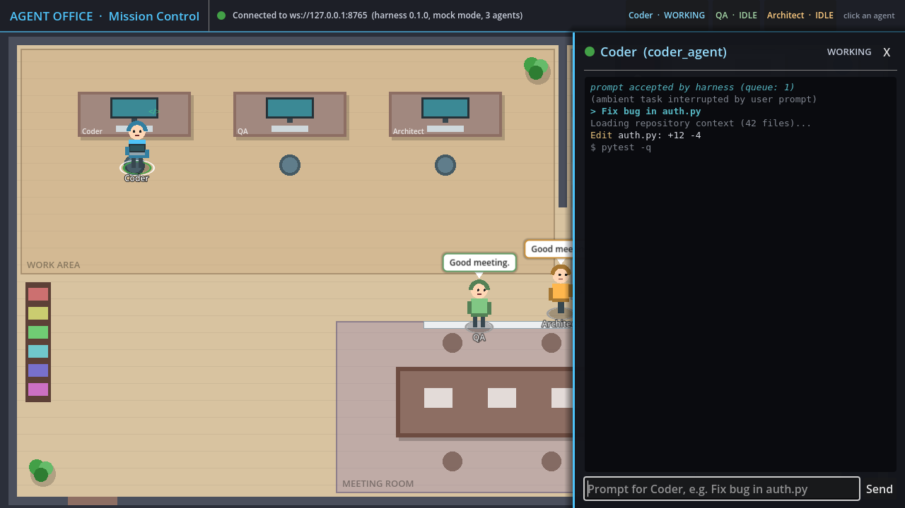
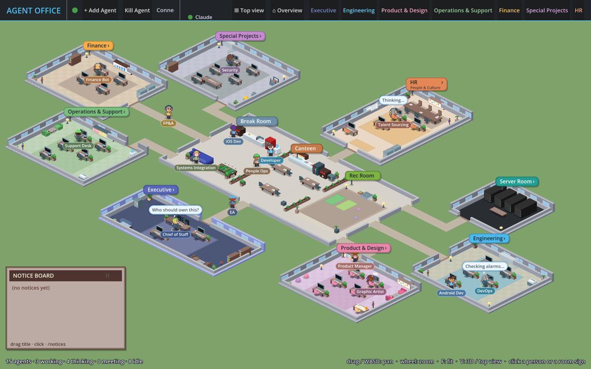
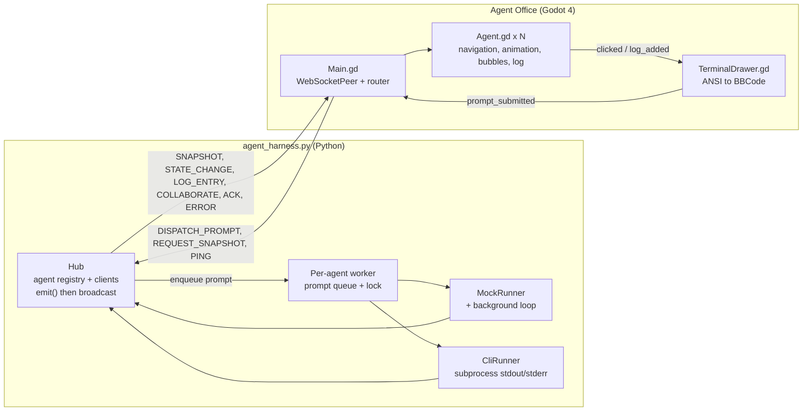

# Agentic Corporation

**Agentic Corporation** is a mission-control dashboard for autonomous coding agents such as Claude Code, Grok, Hermes or any command-line agent. It looks like Sims or Habbo Hotel. The visual client is called **Agent Office**: a 2D office built in Godot 4 where every agent is a small cartoon character whose behaviour shows what the agent is actually doing.



Each state has its own animation:

| State | What you see |
|---|---|
| `WORKING` | The agent walks to its desk and types on a laptop, with `</>` glyphs floating up. |
| `THINKING` | The agent stops with a hand on its chin, an animated "..." cloud and a thought bubble. |
| `IDLE` | The agent wanders to the coffee machine (and holds a cup) or the water cooler. |
| `COLLAB` | Collaborating agents each take a separate seat at the meeting table and talk and wave. |

Clicking an agent slides out a **terminal drawer** with its live log, colour codes included, and a prompt bar that sends work back to that agent.

A small Python **event bridge** (`agent_harness.py`) drives the office over a local WebSocket. It either simulates agents (mock mode) or wraps real CLI processes and streams their output (cli mode).



## Quick start

> **macOS shortcut:** double-click `run-mac.command` to create the venv on first run, start the bridge and open the Godot client (needs `godot` on your PATH, e.g. `brew install --cask godot`). The bridge stops when you close the game.

### 1. Run the harness

You need Python 3.10 or newer.

```bash
git clone https://github.com/pvella/Agentic-Corporation.git
cd Agentic-Corporation

python3 -m venv .venv
source .venv/bin/activate          # Windows: .venv\Scripts\activate
pip install -r requirements.txt    # websockets>=13

python3 agent_harness.py           # mock mode on ws://127.0.0.1:8765
```

**Mock mode** (the default) simulates three agents: `coder_agent`, `qa_agent` and `architect_agent`.

- Every `--tick` seconds (default 5), idle agents pick up fake tasks: they think, walk to their desk, type, print logs, then head for a coffee. About 30% of the time two of them hold a meeting.
- A prompt sent from the dashboard interrupts that agent's background activity and plays a scripted run: THINKING → WORKING at the desk → logs → IDLE at the coffee machine or water cooler.

```bash
python3 agent_harness.py --speed 3 --tick 2   # busier office
python3 agent_harness.py --no-ambient         # only react to prompts
```

**CLI mode** binds a real command to an agent. Each prompt launches that command, streams every stdout/stderr line into the agent's log with ANSI colours kept, and maps process start and exit to WORKING and IDLE.

```bash
# Claude Code in print mode; the prompt is appended as the last argument
python3 agent_harness.py --mode cli --cwd ~/code/myrepo \
  --agent-cmd coder_agent='claude -p --output-format text'

# Any command. {prompt} is substituted where it appears; --prompt-mode none sends no prompt
python3 agent_harness.py --mode cli --prompt-mode none \
  --agent-cmd qa_agent="bash -c 'pytest -q --color=yes'"
```

| Option | Default | Meaning |
|---|---|---|
| `--mode mock\|cli` | `mock` | Choose the runner. |
| `--agent-cmd ID='CMD'` | none | Bind a command to an agent (repeatable, cli mode). |
| `--prompt-mode arg\|stdin\|none` | `arg` | How the prompt reaches the command when `{prompt}` isn't used. |
| `--cwd DIR` | current directory | Working directory for CLI commands. |
| `--cmd-timeout N` | `0` (no limit) | Kill a CLI run after N seconds. |
| `--tick N` / `--speed X` | `5` / `1.0` | Mock-mode pacing. |
| `--no-ambient` / `--ambient` | | Turn background activity off (mock mode) or on for agents without a command (cli mode). |
| `--host` / `--port` | `127.0.0.1` / `8765` | Listen address. |
| `-v` | | Debug logging. |

In cli mode, agents without a `--agent-cmd` fall back to the mock runner when given a prompt. Prompts for the same agent are queued and run one at a time. Ctrl+C shuts down cleanly and kills any running process groups (SIGTERM, then SIGKILL after 3 s).

### 2. Open the office in Godot

You need Godot **4.3 or newer**, the standard (non-.NET) build from [godotengine.org](https://godotengine.org/download), on macOS, Windows or Linux. The project uses the GL Compatibility renderer.

1. Open Godot's Project Manager and choose **Import**. Select `project.godot` in this folder, then **Import & Edit**. The first open builds the import cache in `.godot/`, which git ignores.
2. Press **F5** (Run Project). `Main.tscn` is the main scene.
3. The top bar shows the connection status. The client retries the connection with increasing delays (1 s, doubling up to 15 s), so you can start the harness and Godot in either order.

From the command line, with `godot` on your PATH (on macOS the binary is `Godot.app/Contents/MacOS/Godot`):

```bash
godot --path .                                   # run the office
godot --path . -- --url=ws://127.0.0.1:9000      # connect to another port
godot --path . -- --open-drawer=coder_agent --dispatch="coder_agent:Fix bug in auth.py"
godot --path . -- --screenshot=res://shot.png --screenshot-delay=8 --quit-after-screenshot
```

Options after `--`:
- `--url=` overrides the server address.
- `--open-drawer=ID` opens that agent's terminal once it appears.
- `--dispatch=ID:prompt` sends one prompt after connecting.
- `--screenshot=PATH` saves the viewport after `--screenshot-delay` seconds (default 6). This needs a real renderer, not `--headless`.
- `--quit-after-screenshot` exits once the screenshot is saved.

## Controls

| Input | Action |
|---|---|
| Left-click an agent | Open its terminal drawer. The agent gets a white selection ring. Hovering shows a faint ring. |
| Click a name in the top bar | Open that agent's terminal. |
| Type in the prompt bar, then **Enter** or **Send** | Send a `DISPATCH_PROMPT` to the selected agent. If you're offline, the drawer says the prompt wasn't sent. |
| **Esc** or **X** | Close the terminal drawer. |

The coloured ring at each agent's feet shows its state: grey for IDLE, green for WORKING, yellow for THINKING and purple for COLLAB.

## Stores / distribution

There is no packaged build or store listing yet. Agentic Corporation is a **local desktop tool**: you run the harness and the Godot project from source on your own machine.

## Stack

- **Harness:** Python 3.10+, `asyncio` and `websockets` (13 or newer, using the `websockets.asyncio` API, with a fallback to the legacy API for version 12). Tested with websockets 17.2 on Python 3.13.
- **Client:** Godot 4.3+ in typed GDScript, using the GL Compatibility renderer. There are no external assets: all art is drawn in code. Tested on **Godot 4.3-stable and 4.7.2-stable** (Linux).

## Components

| File | Purpose |
|---|---|
| `agent_harness.py` | WebSocket server. Holds the agent registry and broadcasts every event. Includes `MockRunner` (scripted runs plus background simulation), `CliRunner` (wraps a real process and streams its output) and a per-agent prompt queue. |
| `requirements.txt` | Python dependency (`websockets>=13`). |
| `project.godot` | Godot project settings: 1280x720, GL Compatibility, main scene `Main.tscn`. |
| `Main.tscn` / `Main.gd` | The office scene. Builds the walkable navigation area at startup, defines the `Marker2D` waypoints, runs the `WebSocketPeer` client with automatic retry, routes messages, assigns meeting seats and spreads agents at shared spots, and draws the top bar (status and roster). |
| `Office.gd` | Draws the placeholder office art (floor, walls, desks, coffee machine, water cooler, sofa, meeting table, servers, plants). It also holds the floor and obstacle shapes that the navigation area is built from. |
| `Agent.tscn` / `Agent.gd` | One agent: a `CharacterBody2D` that walks with `NavigationAgent2D` and avoids other agents. It has a character drawn in code, a click `Area2D`, a speech or thought bubble (fades after 3 s), its own log (up to 1000 lines), and an `AnimatedSprite2D` hook for sprite sheets. |
| `TerminalDrawer.tscn` / `TerminalDrawer.gd` | The slide-out terminal on a `CanvasLayer`: header (name, state dot, close), `RichTextLabel` log and prompt bar. It updates live while open. |
| `ansi.gd` | Converts ANSI colour codes to Godot text markup: 16/256/truecolour, bold, dim, italic and underline. Other escape sequences are stripped and literal `[` is escaped. |
| `icon.svg` | Project icon. |
| `tests/test_ansi.gd` | Headless unit tests for the colour converter. |
| `tests/smoke_test.gd` | Headless integration test that loads `Main.tscn` and feeds it protocol messages. |
| `tools/test_client.py` | Python test client for the harness protocol, in mock and cli modes. |
| `docs/images/` | Screenshots used in this README. |

The `*.uid` files are Godot 4.4+ resource IDs and belong in version control. Godot 4.3 ignores them.

## Architecture



- **The harness is the source of truth.** Every event updates the registry before it is broadcast, so a newly connected or reconnected client receives an accurate `SNAPSHOT`, including each agent's last 200 log lines.
- **The client rebuilds itself from snapshots.** A snapshot spawns missing agents, removes ones the server no longer knows about, and re-routes agents whose target changed. An event for an unknown `agent_id` spawns that agent on the fly.
- **Navigation needs no editor step.** `Main._bake_navigation()` feeds `Office.FLOOR` and `Office.OBSTACLES` into `NavigationMeshSourceGeometryData2D` and builds the walkable area at startup. Agents use the built-in collision avoidance and simple stuck detection.
- **Waypoints** are `Marker2D` nodes under `Main/Waypoints`:
  - `Desk_Coder`, `Desk_QA`, `Desk_Architect`
  - `Coffee_Machine`, `Water_Cooler`
  - `Meeting_Table_1` to `Meeting_Table_4`
  - `Entrance`, where agents spawn

  The virtual target `Meeting_Room` resolves to the least-occupied meeting seat. Agents sharing a waypoint each take the lowest free slot around it.

## WebSocket message protocol

All messages are JSON text frames on `ws://127.0.0.1:8765`. Every server-to-client message also carries `ts` (epoch milliseconds).

### Server to client

| `type` | Fields | Client behaviour |
|---|---|---|
| `SNAPSHOT` | `server{name,version,mode}`, `agents[{agent_id,name,role,desk,color,state,target,text,busy,queued,logs[]}]` | Sent when a client connects and in reply to `REQUEST_SNAPSHOT`. The client spawns, updates and removes agents to match, and restores their logs. |
| `STATE_CHANGE` | `agent_id`, `state` (`IDLE`, `WORKING`, `THINKING`, `COLLAB`), optional `target`, optional `text` | Sets the animation state, walks to `target` if given, and shows `text` as a bubble (a thought bubble when `THINKING`). |
| `LOG_ENTRY` | `agent_id`, `log` (raw text, may contain ANSI codes), `stream` (`stdout` or `stderr`) | Appends to the agent's log, and to the drawer if it's open. |
| `COLLABORATE` | `agents[]`, `target` (`Meeting_Room` or a waypoint), optional `text` | Every listed agent switches to `COLLAB` and takes its own seat. The first agent shows the bubble. |
| `ACK` | `action`, `agent_id`, `prompt`, `queued` | Sent only to the client that sent a valid `DISPATCH_PROMPT`. |
| `ERROR` | `message`, optional `action`, `agent_id` | Sent for bad JSON, an unknown action or agent, or an empty prompt. |
| `PONG` | none | Reply to `PING`. |

Example:

```json
{"type": "STATE_CHANGE", "agent_id": "coder_agent", "state": "WORKING", "target": "Desk_Coder", "text": "Editing main.py"}
```

### Client to server

| `action` | Fields | Effect |
|---|---|---|
| `DISPATCH_PROMPT` | `agent_id`, `prompt` | Queues the prompt for that agent and interrupts its background activity. The reply is `ACK` or `ERROR`. |
| `REQUEST_SNAPSHOT` (alias `GET_REGISTRY`) | none | The reply is a `SNAPSHOT`. |
| `PING` | none | The reply is `PONG`. |

```json
{"action": "DISPATCH_PROMPT", "agent_id": "coder_agent", "prompt": "Fix bug in auth.py"}
```

## Running the tests

```bash
# Harness protocol test, mock mode
python3 agent_harness.py --speed 2 --tick 3 &
python3 tools/test_client.py
kill %1

# Harness protocol test, cli mode (checks ANSI lines, the stderr stream and the exit code)
python3 agent_harness.py --mode cli \
  --agent-cmd coder_agent="bash -c 'for i in 1 2 3; do echo -e \"\e[32mline \$i\e[0m\"; sleep 0.3; done'" &
python3 tools/test_client.py --expect-cli
kill %1

# Godot tests. Import once so the class cache exists, then run headless.
godot --headless --path . --import
godot --headless --path . --script res://tests/test_ansi.gd     # colour converter unit tests
godot --headless --path . --script res://tests/smoke_test.gd    # spawning, walking, meeting seats, drawer, pruning
```

`smoke_test.gd` needs no harness: it feeds messages straight into `Main`. Each script exits with code 0 on success and 1 on failure.

## Security

- The harness listens on **127.0.0.1 only** and has **no authentication**. Any local process can connect and send prompts.
- In **cli mode, a prompt runs a real command** on your machine with your user's permissions, in `--cwd`. Only bind commands you trust, and point `--cwd` at a working copy you're happy for an agent to change.
- Don't expose the port beyond localhost (`--host 0.0.0.0`, port forwarding, tunnels) until an auth token is added.

## Roadmap

- **Art:** real sprite sheets through the existing `Agent.sprite_frames` hook (animations `idle`, `walk`, `work`, `think`, `collab`), and `TileMapLayer` office art to replace `Office.gd`'s drawn placeholders, possibly in an isometric, Habbo-style layout.
- **Claude Code:** parse `claude -p --output-format stream-json` so tool calls drive desk work (tool name in the bubble), assistant text becomes thinking or speech bubbles, and `result` ends the run.
- **Other agents:** adapters for Grok and Hermes CLIs and for other agent output formats.
- **Security:** an auth token on the WebSocket, required before the bridge can be used anywhere other than localhost.
- **Hand-offs:** `COLLABORATE` events when one agent passes work to another, e.g. coder to QA review.

## Limitations

- All art is a placeholder drawn in code. There are no sprites, no tiles and no sound.
- The agent list is fixed in `agent_harness.py` (`DEFAULT_AGENTS`: coder, QA, architect) and the office layout and desks are hard-coded. A new agent ID still spawns, but it has no desk of its own and uses an idle spot instead.
- CLI mode treats output as plain lines. It doesn't understand structured output such as stream-json yet, so tool calls don't drive the animation beyond WORKING and the latest line in the bubble.
- There are four meeting seats. A fifth collaborator shares a seat, slightly offset.
- The harness keeps the last 200 log lines per agent and nothing is saved to disk. Restarting the harness clears its history.
- Testing has been on Linux (headless, plus Xvfb with software OpenGL). macOS and Windows should work but haven't been verified. The harness's Ctrl+C handling has a Windows fallback that hasn't been tested.
- There is no authentication (see Security).
